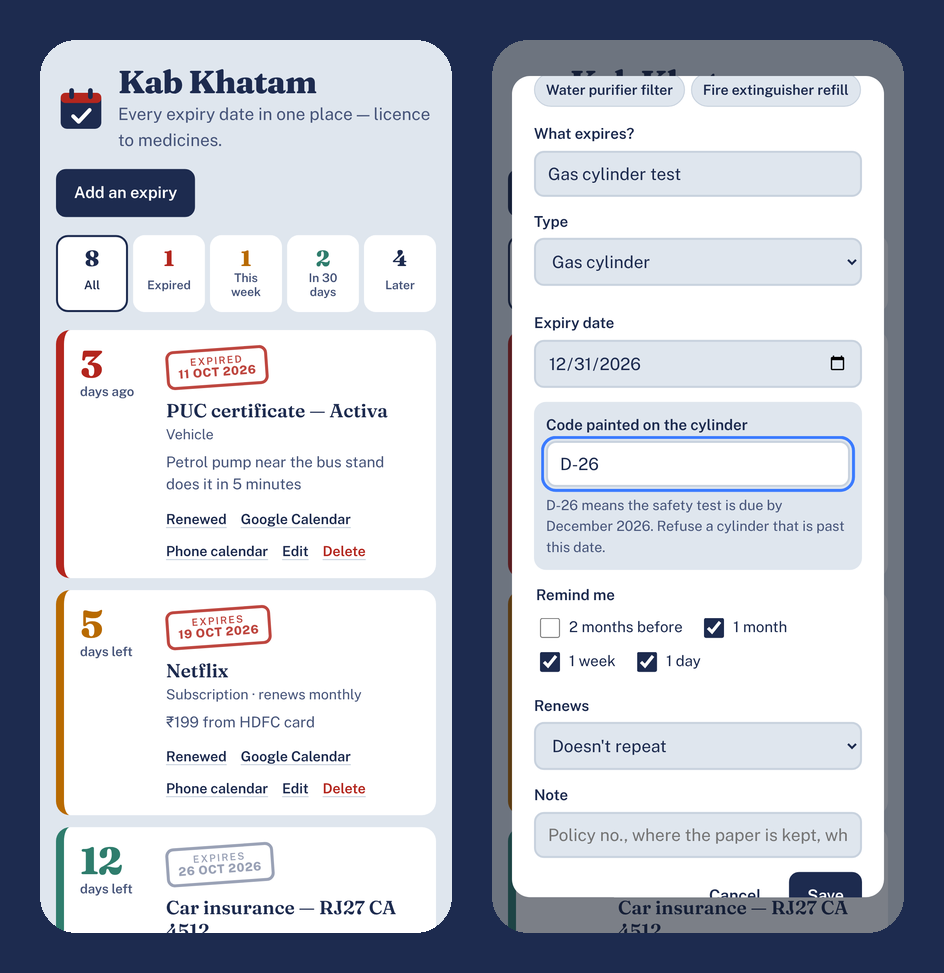

# Kab Khatam

**Track every expiry date in one place — licence, passport, insurance, PUC, medicines, warranties, subscriptions, gas cylinder test — with calendar reminders.**

### ▶ Use it now: https://jainronakwork-jr.github.io/kab-khatam/

Expired PUC means a fine. A lapsed vehicle insurance means you are uninsured on the road. The cough syrup in the cupboard expired last year. Kab Khatam ("when does it end?") keeps every expiry date in one list sorted by urgency, and puts reminders in your phone calendar so you hear about them in time.



## What it does

- Quick-add presets: driving licence, passport, car/bike insurance, PUC, health insurance, medicine, warranty, OTT subscription, water filter, fire extinguisher, gas cylinder test.
- List sorted by urgency with big "days left" numbers and a rubber-stamp expiry date; filters for Expired / This week / In 30 days / Later.
- **Add to phone calendar** (one .ics file for everything) with alarms 2 months / 1 month / 1 week / 1 day before — reminders that work even when the app is closed. Per-item Google Calendar links too.
- **LPG cylinder code decoder**: type the code painted on the cylinder (e.g. `D-26`) and it fills in the safety-test due date.
- Renewing items: one tap rolls monthly/yearly items forward; others ask for the new date.
- Optional alerts each time you open the app.
- Backup and restore as a file. Data stays on your device. Works offline.

## Install it like an app

Open the link on your phone, then:
- **Android (Chrome):** menu ⋮ → *Add to Home screen* / *Install app*.
- **iPhone (Safari):** Share → *Add to Home Screen*.

After the first visit it works with no internet.

## Privacy

There is no server, no account, no analytics. Everything you type is stored only in your own browser on your own device. Clearing your browser data deletes it — use the backup option where available.

## Run it yourself

It is a plain static website — no build step, no dependencies.

```bash
git clone https://github.com/jainronakwork-jr/kab-khatam.git
cd kab-khatam
python3 -m http.server 8000
# open http://localhost:8000
```

Or host the folder on any static host (GitHub Pages, Netlify, Cloudflare Pages).

## Project structure

```
index.html            page
style.css             design
app.js                
sw.js                 offline support (service worker)
manifest.webmanifest  install-as-app settings
fonts/                self-hosted fonts (SIL Open Font License)
icons/, icon.svg      app icons
```

## License

MIT — free to use, share and improve. Fonts are from [Fontsource](https://fontsource.org) under the SIL Open Font License.
